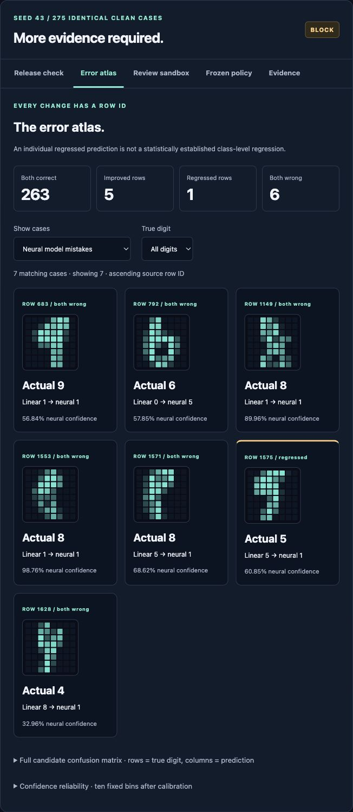
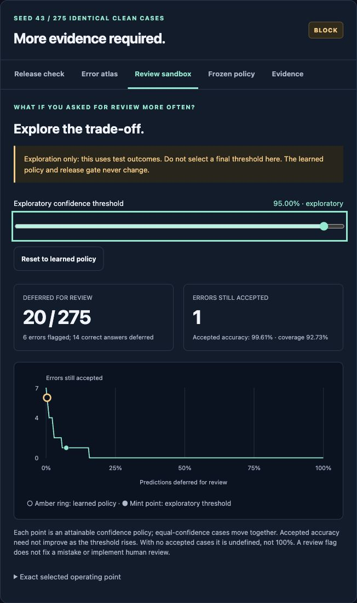

# SelectiveML — Model Release Lab

[](https://github.com/brohum10/selective-ml/actions/workflows/tests.yml)

**A higher model score is not the whole release decision.**

Train a linear classifier and a NumPy neural network, compare them on **identical clean test inputs**, then investigate the decision in an interactive workbench. Follow model disagreements to the exact image, explore review-workload trade-offs, and verify the exported evidence.

## The decision workbench

- **Error atlas:** filter every prediction by true digit and outcome: improved, regressed, both wrong or both correct. Each image keeps its source row ID, both predictions and the candidate's confidence. Pagination preserves ascending row order rather than selecting dramatic examples.
- **Review sandbox:** move a confidence threshold and see review workload, errors still accepted, errors flagged, correct predictions deferred, accepted accuracy and coverage. The amber marker preserves the independently learned policy while the mint marker explores alternatives.
- **Confusion + reliability:** inspect the complete 10×10 candidate confusion matrix and ten fixed confidence bins for the selected seed. Empty bins and empty acceptance stay undefined; descriptive ECE is not a calibration guarantee.
- **Evidence verifier:** inspect an evidence ZIP without extracting or executing it. Reject changed, extra or missing files, duplicate names/JSON keys, unsafe paths, symlinks and oversized archives. A SHA-256 manifest provides integrity relative to that manifest—not cryptographic authenticity.

The threshold curve uses sorting and prefix sums to enumerate attainable policies in **O(n log n)** time, grouping tied confidence values. The browser uses a binary search to select the matching point. A confidence of exactly 1 is not artificially deferred. No UI framework, hosted API or additional Python dependency is required.

**The sandbox uses test outcomes for retrospective exploration. It never replaces the frozen policy, changes a trained model, or changes a gate result. Selecting a production threshold from this view would be test-set tuning; use separate policy data and fresh evaluation instead.**

<details>
<summary>See the actual workbench: error atlas + review sandbox</summary>





The second screenshot explores a 95% confidence threshold on seed 43: 20 cases are deferred, including 6 errors and 14 correct answers; 1 error is still accepted. These are **retrospective test counts**, not a newly validated policy. The release gate stays BLOCK. [Inspect the full descriptive diagnostics](media/workbench-diagnostics.json).

</details>

## See the actual app

https://github.com/user-attachments/assets/9b2a3de1-1f50-4d3d-b599-076d86cd2679

[Watch the approximately 36-second workbench demo](media/SelectiveML-Workbench-Demo.mp4) · [Exact demo facts](media/workbench-demo-facts.json) · [Scope and reproduction](media/README.md)

The video records the working local interface inspecting a completed real experiment: the paired gate, error atlas, exact changed image, confusion matrix, learned policy, exploratory review threshold, confidence bins, evidence exports and all three seed outcomes. Caption bands and a camera close-up of the recorded case card are added in editing. It does not show training in real time. No UI or predictions are generated for the video; it is not a production deployment. [The exact recorded evidence ZIP](media/workbench-demo-evidence.zip) includes all original model outputs and an unsigned integrity manifest. Earlier recordings remain available in the [media history](media/README.md).

## Run the local interface

Python 3.12+ and NumPy are sufficient. Keep [EvalDelta](https://github.com/brohum10/evaldelta) in a sibling folder:

```sh
git clone https://github.com/brohum10/selective-ml.git
git clone https://github.com/brohum10/evaldelta.git
cd selective-ml
python -m venv .venv
source .venv/bin/activate
python -m pip install -r requirements.txt
python lab_server.py --evaldelta ../evaldelta/evaldelta.py
```

Open **http://127.0.0.1:8766** and click **Run real experiment**. Each click trains six real models: two architectures for each of seeds 42, 43 and 44. No API keys, cloud inference or pretrained weights.

On Windows, activate with `.venv\Scripts\activate`. The viewer binds only to loopback, validates Host/Origin and a session token for run requests, permits one active experiment, and serves only allowlisted assets and the completed run's evidence. It is a local learning tool, not an authenticated internet-facing service.

## What the real comparison found

Both architectures use the same training examples, fixed 120 epochs, and separate calibration and policy splits. The candidate is a **64→64 ReLU→10 neural network**; the baseline is linear softmax.

| Seed | Linear V1 accuracy | Neural V2 accuracy | Configured gate |
|---|---:|---:|---|
| 42 | 96.36% | 97.45% | PASS |
| 43 | 96.00% | 97.45% | BLOCK: digit-5 check inconclusive |
| 44 | 95.64% | 97.82% | PASS |

Each run evaluates **275 clean test images**. The neural model scores higher in every run. In seed 43, however, the 28 digit-5 cases have an approximate paired score-difference interval of **[-10.71, 0.00] percentage points**. That does not establish the configured maximum allowed loss of 2 percentage points.

**Inconclusive is not proof that the candidate is worse.** The gate blocks because its non-regression requirement was not established. PASS means the configured empirical checks passed, not that the system is safe to deploy.

Every seed is retained. The interface defaults to seed 42; the video inspects seed 43 because it is the first blocked run in fixed seed order, not the best-scoring seed. Test sets overlap across seeds and must not be pooled as independent observations.

This is a **retrospective educational analysis of an already explored dataset**, not a new blind benchmark. Random row splits do not establish generalization to unseen writers.

## Review policies: the useful behavior and the failures

Thresholds are learned only on the policy split, then frozen before test evaluation:

| Seed | Test predictions deferred | Errors deferred | Errors still accepted | Correct predictions deferred |
|---|---:|---:|---:|---:|
| 42 | 0 | 0 | 7 | 0 |
| 43 | 1 | 1 | 6 | 0 |
| 44 | 7 | 2 | 4 | 5 |

The first deferred row in fixed seed/row order is seed 43, row 1628: true digit **4**, prediction **1**, confidence **32.96%**. It is an unmodified test image, not a noisy example selected by maximum confidence.

This is not a claim that confidence thresholds prevent all mistakes. Seed 42 accepts everything; seed 44 also defers five correct answers. The empirical 98% policy-selection target is missed on two held-out splits. A review signal does not implement a human-review service.

## Architecture

```text
Checksum-verified public digits + checked-in protocol
  ├─ training rows → linear V1 / neural V2 (backpropagation + Adam)
  ├─ calibration rows → independent temperature fits
  ├─ policy rows → frozen accept/review thresholds
  └─ identical clean test rows → both sets of actual predictions
                                     ↓
             ID + task-hash + scorer + class-label alignment
                                     ↓
                  actual EvalDelta CLI / paired intervals
                                     ↓
          all-seed report + controls + exported models + hashes
                                     ↓
                   loopback-only interactive inspector
```

The protocol is in [lab_protocol.json](lab_protocol.json). The comparator source checksum is pinned to the reviewed EvalDelta revision `901c809ac52147c5ce4d79006cc720476457d252`; other comparator code is rejected before execution.

The baseline and candidate each have their own calibration temperature and policy threshold. Test-set calibration can still get worse: the neural model's held-out negative log-likelihood worsens after calibration in seeds 42 and 44. Those negative results are retained.

## Command-line use and CI behavior

```sh
python release_lab.py --evaldelta ../evaldelta/evaldelta.py \
  --output results/release-lab/my-new-run
```

The output directory must be **new**; earlier evidence is never overwritten. Without `--enforce`, exit 0 means analysis completed, not that every model check passed.

For a CI job that must fail on any blocked planned run:

```sh
python release_lab.py --evaldelta ../evaldelta/evaldelta.py \
  --output results/release-lab/my-enforced-run --enforce
```

Exit **1** means at least one planned run is blocked. Exit **2** means invalid input or an execution error. With this fixed protocol, the seed-43 inconclusive result makes the enforced run return 1. No automatic deployment is implemented.

The existing `verify_gate.py` also verifies comparator pass/block/invalid CLI outcomes using the original noise-stress fixture. That older fixture is a **separate robustness illustration**, not the new model-release comparison.

## Evidence you can inspect

Each new run writes:

- Every split's exact row membership, both exported model artifacts and their hashes.
- Every clean test input, true label, probability vector, prediction and review decision.
- Aligned baseline/candidate JSONL files; no manually entered scores.
- Every class-level gate result, all passing identical-run controls, and the exact protocol.
- Source/data/comparator fingerprints, runtime versions and a SHA-256 file manifest.
- A separately labeled noise-stress report, excluded from the release gate.

Timing records are local per-example inference wall times, including NumPy conversion. They are not serving benchmarks or SLA claims. Timing-dependent hashes can vary across runs.

### Verify the recorded bundle

```sh
python audit_evidence.py media/release-lab-evidence.zip
```

Exit 0 means all listed files match the unsigned manifest and the planned seed evidence is present. Exit 2 means invalid, incomplete or changed evidence. The verifier is standard-library-only, does not extract anything, and caps archives at 200 members / 64 MB expanded. Replacing both files and hashes can defeat this integrity check; it is not a signature or proof of scientifically valid results.

### Export descriptive diagnostics

After a fresh command-line run:

```sh
python diagnostics.py --report results/release-lab/my-new-run/summary.json --output results/diagnostics.json
```

The output path must be new. In the interface, **Evidence → Diagnostic JSON** downloads the same analysis schema. Diagnostics are separate from the original evidence bundle so the original manifest and results stay intact. The frozen model/version comparison and recorded video are preserved unchanged.

The original [three-seed metrics](results/reference/metrics.json), [seed-42 artifact](results/reference/model.json), and [model card](MODEL_CARD.md) remain available. Their legacy architecture and inference commands are unchanged:

```sh
python selective_ml.py experiment --output results/local
python report.py results/local
python selective_ml.py predict --model results/reference/model.json --input results/reference/example.json
```

## Noise is a separate experiment

The viewer's collapsed noise panel applies seeded Gaussian corruption (sigma 0.2 on normalized pixels, clipped to [0,1]). It reports **agreement with original labels**. Corruption may change a digit's appearance; label preservation has not been established. It is neither the candidate model comparison nor a realistic out-of-distribution benchmark. No confident-noisy-error example is used as the new video's headline.

## Tests

```sh
EVALDELTA_SCRIPT=../evaldelta/evaldelta.py OPENBLAS_NUM_THREADS=1 python -m unittest -v
```

There are **63 SelectiveML tests**, including finite-difference gradient checks, reproducible training, split independence, full prediction recomputation from exported models, exact pairing, real CLI enforcement, manifests, bounded worker behavior, failure states and local HTTP request validation. New coverage checks confusion-matrix orientation, every threshold boundary against brute-force counts, confidence ties, empty acceptance, original-policy compatibility, CLI overwrite prevention and malformed evidence archives.

The integration workflow also runs **34 tests from the pinned EvalDelta revision**, exercises its real CLI, trains all six models on Python 3.12 and 3.14, and retains fresh evidence artifacts. Gate intervals are approximate and unadjusted per slice; neither the tests nor the gate establish production safety.

## Attribution and scope

Dataset: E. Alpaydin and C. Kaynak, [Optical Recognition of Handwritten Digits](https://doi.org/10.24432/C50P49), UCI (1998), CC BY 4.0, using the 1,797-row scikit-learn subset. See [data provenance](data/README.md). Writer identity is unavailable in this subset.

Temperature scaling: Guo et al., [On Calibration of Modern Neural Networks](https://proceedings.mlr.press/v70/guo17a.html), ICML 2017. This is an educational implementation, not a reproduction of that paper's experiments.

Developed with AI assistance. Results come from executable experiments; no production users, savings, LLM performance or novel research claims are implied.
