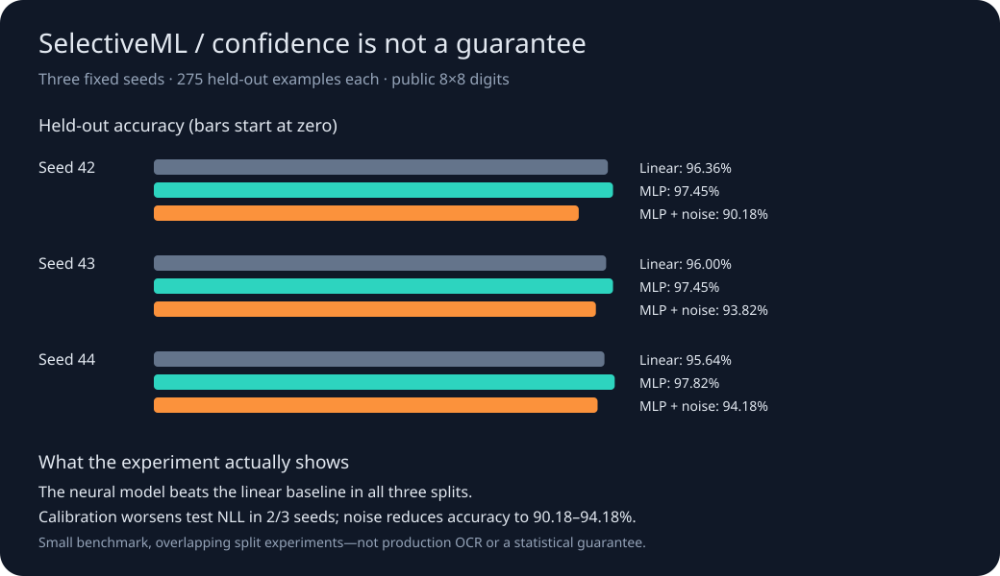

# SelectiveML

[](https://github.com/brohum10/selective-ml/actions/workflows/tests.yml)

**A model should know when to ask for help. How do you measure whether it does?**

A compact, inspectable ML engineering project: train a neural classifier from scratch, calibrate its confidence, choose a review threshold without touching the test set, and expose where that policy breaks. NumPy is the only dependency. No API keys, downloaded model weights, or private data.

## Watch the 40-second walkthrough

https://github.com/user-attachments/assets/330c3618-8430-4a2c-9ecd-c301f27d25bd

**[Watch the demo](https://github.com/user-attachments/assets/330c3618-8430-4a2c-9ecd-c301f27d25bd)** · [Inspect the recorded gate result](media/gate.json) · [Demo scope and attribution](media/README.md) · [Download MP4](media/SelectiveML-LinkedIn-Demo.mp4)

Real neural-network inference → simulated input corruption → all 275 held-out
cases → a paired evaluation gate. The captioned video is a visual replay of actual
local outputs, not a production deployment or a screen recording. The model's
confidence rises from 60.7% to 96.1% on one selected example while its answer changes
from the correct digit **3** to the incorrect digit **8**.

<details>
<summary>See the full three-seed experiment dashboard</summary>



</details>

## Results, not just a demo

The checked-in experiment uses the public 1,797-image digits dataset. Each seed has 984 training, 268 calibration, 270 policy-selection, and 275 test examples.

| Seed | Linear accuracy | Neural accuracy | Test coverage | Accepted accuracy | Noisy-input accuracy |
|---|---:|---:|---:|---:|---:|
| 42 | 96.36% | 97.45% | 100.00% | 97.45% | 90.18% |
| 43 | 96.00% | 97.45% | 99.64% | 97.81% | 93.82% |
| 44 | 95.64% | 97.82% | 97.45% | 98.51% | 94.18% |

These are **small benchmark results**, not production performance. The three test sets overlap: do not pool them as 825 independent observations. The 98% policy target is empirical on the policy split, **not a test-set or deployment guarantee**. Temperature scaling worsened held-out negative log-likelihood in two of three seeds. That negative result is retained.

## Run it

Python 3.12+; reference run: Python 3.12.14, NumPy 2.5.2. A standard CPU is sufficient.

```sh
python -m venv .venv
source .venv/bin/activate
python -m pip install -r requirements.txt
python -m unittest -v
OPENBLAS_NUM_THREADS=1 python selective_ml.py experiment --output results/local
python report.py results/local
python selective_ml.py predict --model results/local/model.json --input results/local/example.json
```

On Windows use `.venv\Scripts\activate` and omit the environment-variable prefix. Inspect `results/local/dashboard.svg` and `metrics.json`. The checked-in model also runs immediately using the same predict command with `results/reference`.

## Reproduce the inference-to-release-gate walkthrough

```sh
python walkthrough.py --output results/walkthrough
```

This runs the frozen seed-42 model on **all 275 held-out images**, then the same
images with seeded Gaussian noise (sigma 0.2 on normalized pixels, clipped to
[0, 1]). It exports the actual predictions, input pixels, model fingerprint,
measured per-example inference wall times, and paired evaluation files. No
retraining, API keys, fabricated model outputs, or manual score entry is involved.
The default run reproduces 7 clean errors versus 27 noisy-input errors. These are
small-dataset robustness results, not production or realistic OOD measurements.
For its selected failure example, the trace also records 41 real forward passes
as noise increases from zero to the configured sigma. Displayed confidence values
come from those predictions, not animation interpolation.

With [EvalDelta](https://github.com/brohum10/evaldelta) in a sibling directory:

```sh
python verify_gate.py --evaldelta ../evaldelta/evaldelta.py
```

The integration verifier checks three distinct CLI outcomes: noise stress blocks
(exit 1), an identical-run control passes (exit 0), and a changed case hash is
rejected (exit 2). It writes fresh `gate.json`, `control.json`, and `integration.json`
beside the prediction trace. A successful verifier exits 0 after confirming all
three outcomes. The GitHub Actions workflow runs these checks on Python 3.12 and
3.14 against a pinned EvalDelta revision and retains generated evidence artifacts.

To invoke the comparator directly instead:

```sh
python ../evaldelta/evaldelta.py results/walkthrough/baseline.jsonl \
  results/walkthrough/candidate.jsonl --margin 0.02 --min-cases 20 \
  --samples 2000 --seed 42 --max-p95-ms 1000 > results/walkthrough/gate.json
```

Exit **1** means the gate blocked the comparison; it is the expected result of
this stress test, not a failed installation. The candidate is the same model
behind a corrupted-input pipeline, **not a new model version**. Case hashes cover
the original task and answer; digit-class slices remain aligned across runs.
The 1,000 ms budget is a configured bound, not a claimed serving SLA. Exact
timings and their report fingerprints vary by machine and run.

The frozen seed-42 learned threshold is **0**, so it accepts every example—even
some confident mistakes. This is intentionally visible: uncertainty-based
deferral is not a correctness guarantee. The exported `featured_row` follows a
documented deterministic rule to illustrate one failure; aggregate metrics use
the whole test set. The approximate per-slice bootstrap intervals are unadjusted
and should not be interpreted as production safety certificates.

## Architecture and protocol

```text
Checksum-verified pixels, divided by the fixed constant 16
  ├─ train:       Adam → linear softmax baseline + 64→64 ReLU→10 MLP
  ├─ calibration: fixed temperature grid → minimum calibration NLL
  ├─ policy:      maximum coverage with ≥98% empirical accuracy, ≥50% coverage
  └─ test:        accuracy / macro-F1 / NLL / Brier / ECE / errors / noise stress
                              ↓
                   JSON model → validated batch inference → accept or review
```

- Both models use fixed 120-epoch training, batch size 64, learning rate 0.003, L2 0.0001. No test-driven tuning or early stopping.
- The MLP has **4,810 trainable parameters**. Backpropagation and Adam are implemented directly and checked against finite-difference gradients.
- Temperature is selected from a fixed logarithmic grid [0.25, 4]. It changes confidence, not predicted labels.
- If no policy threshold satisfies the development constraint, every prediction is deferred. “Review” is a signal, not an implemented human-review service.
- The corruption stress test adds fixed-seed Gaussian noise, sigma 0.2 on normalized pixels, then clips to [0,1]. It is not a realistic out-of-distribution benchmark.
- Export uses JSON rather than executable pickle; inference validates input range, shapes, finite weights and outputs.

## Evidence you can inspect

- [`metrics.json`](results/reference/metrics.json): all seeds, majority/linear/neural baselines, calibration bins, confusion matrices, per-class recall, risk/coverage points, every wrong prediction, and bootstrap accuracy intervals.
- [`splits.json`](results/reference/splits.json): exact row membership for seed 42; other seeds reproduce deterministically.
- [`model.json`](results/reference/model.json): seed-42 weights, temperature and policy; no “best-seed” selection.
- [`test_selective_ml.py`](test_selective_ml.py): gradient checks, data integrity, split independence, policy failure, calibration objective, reproducibility, tiny-set overfit, safe input handling and artifact round trip.
- [`test_walkthrough.py`](test_walkthrough.py): paired export integrity, exact seed-42 split, seeded noise, reproducible failure selection, and actual noise-sweep inference.
- [`verify_gate.py`](verify_gate.py): executable pass/block/invalid integration checks with EvalDelta.
- [`MODEL_CARD.md`](MODEL_CARD.md): limitations and intended use.

## What I would improve next

Use a harder task with a writer- or source-independent split, compare PyTorch and classical baselines, add conformal prediction with explicit assumptions, and evaluate human-review cost. Do not infer that digit-recognition accuracy demonstrates LLM, production computer-vision, or employer-data performance.

## Attribution

Dataset: E. Alpaydin and C. Kaynak, [Optical Recognition of Handwritten Digits](https://doi.org/10.24432/C50P49), UCI (1998), CC BY 4.0. This repository vendors the 1,797-row subset distributed by [scikit-learn](https://scikit-learn.org/stable/modules/generated/sklearn.datasets.load_digits.html); it does **not** reproduce the original UCI writer split. See [data provenance](data/README.md).

Temperature-scaling reference: Guo et al., [On Calibration of Modern Neural Networks](https://proceedings.mlr.press/v70/guo17a.html), ICML 2017. This is an educational implementation, not a reproduction of that paper's experiments. Developed with AI assistance; results come from the executable experiment, not generated claims.
