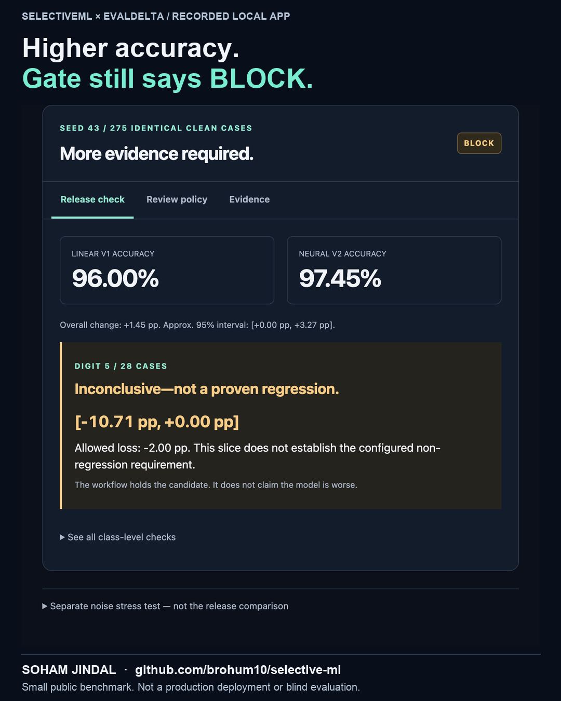

# Model Release Lab: recorded application demo

[Watch the 29-second screen recording](SelectiveML-Release-Lab-Demo.mp4)



This video records the actual local interface training and evaluating two model
architectures across seeds 42, 43 and 44. Caption bands are added outside the
browser capture. It is intentionally silent; an SRT file is included. The opening
shows a completed run before starting a new execution of the same fixed protocol.
It is not a generated mockup, hosted service or production deployment.

## What the recording establishes

| Seed | Linear accuracy | Neural accuracy | Configured release check |
|---|---:|---:|---|
| 42 | 96.36% | 97.45% | PASS |
| 43 | 96.00% | 97.45% | BLOCK: inconclusive digit-5 slice |
| 44 | 95.64% | 97.82% | PASS |

Each comparison uses 275 identical clean test inputs and labels. All three planned
seeds remain visible; their overlapping test sets are not pooled. Seed 43 is
inspected because it is the first blocked run in fixed order. Its 28 digit-5
examples have an approximate paired interval of [-10.71, 0.00] percentage points,
which does not establish the configured maximum allowed loss of 2 points.
**Inconclusive does not establish that the candidate got worse.**

The policy panel also shows limitations: seed 43 defers one mistake but accepts
six others. Seed 42 defers nothing; seed 44 defers five correct answers. No human
review service is implemented. Thresholds are selected on a separate policy split.

## Inspect and reproduce

- [Compact recorded report](release-lab-summary.json): all seeds, gates, policies,
  environment, source fingerprints, selection rule and limitations.
- [Complete recorded evidence ZIP](release-lab-evidence.zip): exact splits,
  exported weights, every prediction, paired JSONL, controls and SHA-256 manifest.
- [Caption file](SelectiveML-Release-Lab-Captions.srt).

With EvalDelta in a sibling directory, follow the [main setup](../README.md), then:

```sh
python lab_server.py --evaldelta ../evaldelta/evaldelta.py
```

Or produce a fresh evidence bundle without the interface:

```sh
python release_lab.py --evaldelta ../evaldelta/evaldelta.py --output results/release-lab/new-run
```

Exit 0 means analysis completed. Add `--enforce` to return 1 if any planned seed
is blocked. Invalid input or execution failure returns 2. Existing output folders
are never overwritten. The recorded comparison used NumPy 2.5.2 and Python 3.12;
timings and timing-dependent hashes vary across runs and are not serving metrics.

This is a retrospective educational analysis of an already explored public
dataset, not a new blind benchmark or proof of unseen-writer generalization.
Intervals are approximate and unadjusted per slice. PASS is not a safety guarantee.

## Earlier noise-stress illustration

[The earlier 40-second video](SelectiveML-LinkedIn-Demo.mp4),
[stress report](gate.json) and [identical-run control](control.json) are preserved
for history. That video is a rendered replay of a frozen model's clean/noisy
predictions, **not** a screen recording or model-version comparison. Corruption
may alter a digit's appearance: its reported 97.45% clean and 90.18% corrupted
results should be interpreted as agreement with the original labels, not
validated accuracy on a label-preserving corruption benchmark. The new video's
release gate excludes noisy inputs entirely.

## Attribution

UCI Optical Recognition of Handwritten Digits, E. Alpaydin and C. Kaynak (1998),
CC BY 4.0, using the 1,797-row scikit-learn subset. See [data provenance](../data/README.md).
The educational project and presentation were developed with AI assistance.
All reported predictions come from executable models; no production impact is implied.
