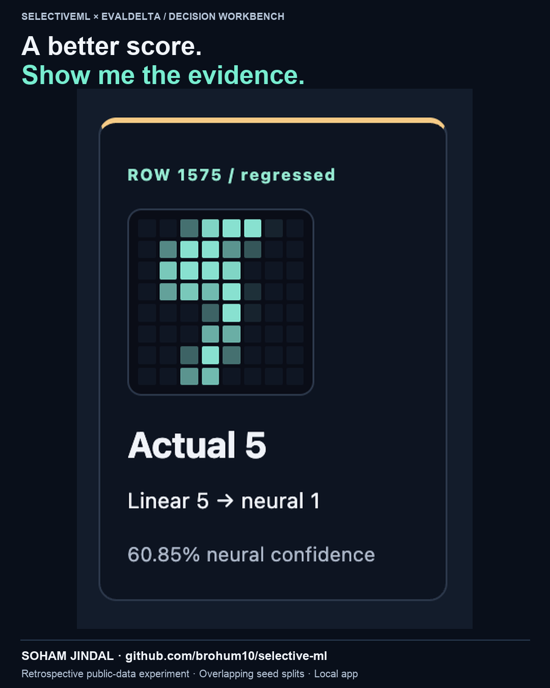

# Model Release Lab: recorded application demos

## Latest: 36-second decision workbench

[Watch the updated workbench recording](SelectiveML-Workbench-Demo.mp4)



Actual local app recording of a completed, real model experiment: paired gate,
error atlas, an individual newly wrong prediction, confusion matrix, learned
review policy, exploratory threshold/workload curve, confidence bins, evidence
exports and all three planned seeds. The video is intentionally silent and has
on-screen explanations plus [optional SRT captions](SelectiveML-Workbench-Captions.srt).
Title/footer bands and a camera close-up of the recorded row-1575 card are added
outside/within the captured pixels. No digit image, pointer action, UI state or
model prediction is fabricated. This video inspects completed results; it does
not show training in real time.

The selected seed is 43, the first blocked run in fixed seed order. The case
filter is linear-correct/neural-wrong and true digit 5; row 1575 is its only case.
It is an individual changed prediction, not proof of a class-level regression.
The digit-5 gate remains inconclusive under the configured non-regression margin.

At the independently learned policy threshold: 1 error deferred, 6 still accepted.
At the explored 95% confidence threshold: 20 cases deferred, including 6 errors
and 14 correct predictions; 1 error still accepted. The latter is a retrospective
test-set what-if, not a validated policy, deployment improvement or fitted result.
The frozen policy and gate are never modified by the sandbox.

- [Exact demo facts and scope](workbench-demo-facts.json): all seed outcomes,
  row selection, thresholds, counts, source fingerprints and video checksum.
- [Exact recorded experiment ZIP](workbench-demo-evidence.zip): exported models,
  input rows, predictions, paired JSONL, controls, reports and manifest.

The existing verifier checked all **32 manifest-listed files** in that exact ZIP
without extracting or executing bundle files. Hashes are unsigned: integrity
relative to a manifest is not proof of authenticity or scientific validity.

```sh
python audit_evidence.py media/workbench-demo-evidence.zip
```

This is a retrospective learning project on a small public dataset. Seed test
sets overlap and must not be pooled; approximate intervals are unadjusted per
slice. The application is local, not a production deployment or blind benchmark.
The project and presentation were developed with AI assistance.

## Decision workbench extension

The new [error atlas](workbench-error-atlas.png) and
[review sandbox](workbench-review-sandbox.png) screenshots come from actual local
app interaction. [Diagnostic JSON](workbench-diagnostics.json) retains every seed,
the change counts, confusion matrices, confidence bins and exact threshold curves.
Its source fingerprint identifies `diagnostics.py`. These descriptive outputs
are separate from the original video/evidence bundle below; the original results
and manifest have not been overwritten.

The sandbox screenshot explores 95% confidence on seed 43: 20 cases deferred,
6 errors flagged, 14 correct answers deferred, 1 error still accepted. This is a
test-set what-if, not policy training or fresh validation. The frozen policy and
BLOCK result do not change. The earlier recording below predates these extra panels;
the latest recording above includes them.

## Earlier: 29-second model-comparison recording

[Watch the 29-second screen recording](SelectiveML-Release-Lab-Demo.mp4)


This video records the actual local interface training and evaluating two model
architectures across seeds 42, 43 and 44. Caption bands are added outside the
browser capture. It is intentionally silent; an SRT file is included. The opening
shows a completed run before starting a new execution of the same fixed protocol.
It is not a generated mockup, hosted service or production deployment.

## What the recording establishes

| Seed | Linear accuracy | Neural accuracy | Configured release check |
|---|---:|---:|---|
| 42 | 96.36% | 97.45% | PASS |
| 43 | 96.00% | 97.45% | BLOCK: inconclusive digit-5 slice |
| 44 | 95.64% | 97.82% | PASS |

Each comparison uses 275 identical clean test inputs and labels. All three planned
seeds remain visible; their overlapping test sets are not pooled. Seed 43 is
inspected because it is the first blocked run in fixed order. Its 28 digit-5
examples have an approximate paired interval of [-10.71, 0.00] percentage points,
which does not establish the configured maximum allowed loss of 2 points.
**Inconclusive does not establish that the candidate got worse.**

The policy panel also shows limitations: seed 43 defers one mistake but accepts
six others. Seed 42 defers nothing; seed 44 defers five correct answers. No human
review service is implemented. Thresholds are selected on a separate policy split.

## Inspect and reproduce

- [Compact recorded report](release-lab-summary.json): all seeds, gates, policies,
  environment, source fingerprints, selection rule and limitations.
- [Complete recorded evidence ZIP](release-lab-evidence.zip): exact splits,
  exported weights, every prediction, paired JSONL, controls and SHA-256 manifest.
- [Caption file](SelectiveML-Release-Lab-Captions.srt).

With EvalDelta in a sibling directory, follow the [main setup](../README.md), then:

```sh
python lab_server.py --evaldelta ../evaldelta/evaldelta.py
```

Or produce a fresh evidence bundle without the interface:

```sh
python release_lab.py --evaldelta ../evaldelta/evaldelta.py --output results/release-lab/new-run
```

Exit 0 means analysis completed. Add `--enforce` to return 1 if any planned seed
is blocked. Invalid input or execution failure returns 2. Existing output folders
are never overwritten. The recorded comparison used NumPy 2.5.2 and Python 3.12;
timings and timing-dependent hashes vary across runs and are not serving metrics.

This is a retrospective educational analysis of an already explored public
dataset, not a new blind benchmark or proof of unseen-writer generalization.
Intervals are approximate and unadjusted per slice. PASS is not a safety guarantee.

## Earlier noise-stress illustration

[The earlier 40-second video](SelectiveML-LinkedIn-Demo.mp4),
[stress report](gate.json) and [identical-run control](control.json) are preserved
for history. That video is a rendered replay of a frozen model's clean/noisy
predictions, **not** a screen recording or model-version comparison. Corruption
may alter a digit's appearance: its reported 97.45% clean and 90.18% corrupted
results should be interpreted as agreement with the original labels, not
validated accuracy on a label-preserving corruption benchmark. The new video's
release gate excludes noisy inputs entirely.

## Attribution

UCI Optical Recognition of Handwritten Digits, E. Alpaydin and C. Kaynak (1998),
CC BY 4.0, using the 1,797-row scikit-learn subset. See [data provenance](../data/README.md).
The educational project and presentation were developed with AI assistance.
All reported predictions come from executable models; no production impact is implied.
