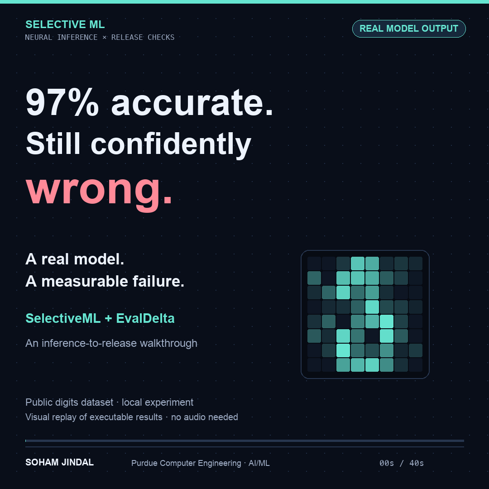

# Inference-to-release-gate demo

[Watch the 40-second captioned video](SelectiveML-LinkedIn-Demo.mp4)



This is a visual replay of actual local SelectiveML inference and EvalDelta CLI
outputs. It is not a screen recording, a live deployment, or a production claim.
The video is intentionally silent; explanations are on-screen and an SRT caption
file is included. No generated model outputs or fabricated performance values are
used.

## What the run measures

The same frozen seed-42 NumPy model evaluates all **275 held-out public digit
images** twice: once clean, once with seeded Gaussian noise (sigma 0.2 on normalized
pixels, clipped to [0, 1]). This is a simulated robustness test, not a new-model
comparison or a realistic out-of-distribution benchmark.

| Measure | Recorded result |
|---|---:|
| Clean accuracy | 268/275 = 97.45% |
| Noise-stress accuracy | 248/275 = 90.18% |
| Paired accuracy change | -7.27 percentage points |
| Approximate 95% paired percentile bootstrap interval | [-10.55, -4.36] pp |
| Configured allowed loss | 2 pp |
| Stress comparison | BLOCK, CLI exit 1 |
| Clean-vs-clean control | PASS, CLI exit 0 |

The intervals are unadjusted per slice; they are not simultaneous guarantees or
production safety certificates. [Recorded stress result](gate.json) and
[control result](control.json) include the complete gate configuration.

The featured image is row 448, true label **3**. The clean prediction is **3** at
60.7% confidence; the noisy prediction is **8** at 96.1%. The exporter selects the
first newly wrong test row with stress confidence at least 95%, falling back to
the first newly wrong row. This selected example illustrates a failure; aggregate
accuracy uses the entire held-out split. The video noise sweep uses **41 actual
forward passes**, not interpolated confidence values.

The frozen model's learned threshold is zero, so it accepts every example,
including this error. The demo intentionally exposes this limitation.

## Reproduce and verify

From the SelectiveML repository, with EvalDelta in a sibling folder:

```sh
python -m pip install -r requirements.txt
python -m unittest -v
python verify_gate.py --evaldelta ../evaldelta/evaldelta.py
```

The verifier regenerates the inputs and checks the actual CLI's block, pass, and
invalid-input behavior. Fresh outputs include every input image and prediction,
model/data hashes, split membership via row IDs, the deterministic noise sweep,
and gate reports. Timings and report fingerprints vary between machines; timings
are not model-serving benchmarks. The demonstration was tested locally with 19
SelectiveML tests and 34 EvalDelta tests; remote check results are shown by the
repository's Actions badge.

## Data and development attribution

UCI Optical Recognition of Handwritten Digits, E. Alpaydin and C. Kaynak (1998),
CC BY 4.0, using the 1,797-row scikit-learn subset. See [data provenance](../data/README.md).
The educational project and presentation were developed with AI assistance.
Reported predictions come from the executable model, not generated claims.
